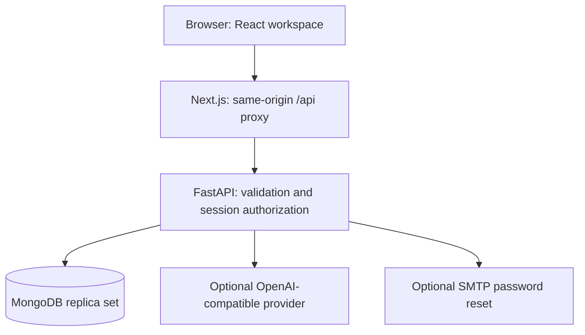
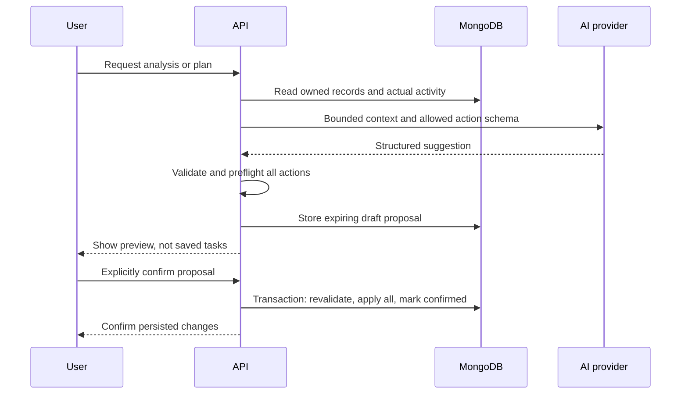

# Architecture

## Request flow

The frontend uses the App Router and TypeScript, modular React feature components, custom responsive CSS, Lucide icons and Recharts. A client workspace provider authenticates through `/auth/me`, loads real resources, refreshes after writes and every minute while visible, and exposes fetch failures rather than substituting sample records. Light/dark preferences are local UI state, not authentication storage.

The browser uses the frontend's `/api` origin. Next rewrites to server-only `BACKEND_URL`; the API cookie is HttpOnly and host-only. Backend authorization is authoritative for every private resource. The client authentication gate is UX, not an access-control boundary. Static route bundles contain no user records; authenticated JSON responses are not cached.

FastAPI uses synchronous PyMongo endpoints. Input models reject unknown keys, enforce bounded fields and require timezone-aware dates. Business rules verify owned foreign keys, scheduling conflicts, and date ordering. Mongo startup installs unique, ownership, time and TTL indexes.

## Data integrity

Every domain writer touches the user's revision document inside a Mongo transaction. Concurrent mutations for the same user therefore conflict, including overlapping schedule writes and project deletion vs task creation. This avoids relying on in-process locks for domain correctness. Completion events, task changes and cascading cleanup commit together. A replica set is required; unsupported transactions never silently fall back to non-atomic production writes.

Records use UUID strings externally and `user_id` ownership internally. User IDs come from validated sessions, never request-body authority. Project deletion detaches tasks; task deletion removes its schedules and related notifications, while genuine historical completion events remain.

## AI lifecycle

Only `create_task` and `schedule_task` actions are allowed. AI cannot supply recorded time or completed tasks, invent foreign IDs, or bypass ownership checks. Pending proposals expire after 24 hours. Confirmed proposals retain their idempotency record; retries cannot recreate actions. Failed batches roll back. Analysis-only responses contain no writes.

The provider receives relevant private workspace content. User-provided content is marked untrusted; server validation remains the actual security boundary. Model advice cannot be guaranteed perfectly accurate and must remain reviewable.

## Reporting and reminders

Current totals/progress derive from stored task state. Completion charts derive from actual transition events, bucketed in the user's timezone. Reopening/deleting tasks does not falsify historical events. A task contributes at most once per local day to daily-count charts, with hourly reporting grouped by local hour; repeated daylight-saving hours share a bucket.

Notifications scan on read, with owner/event/time deduplication. The open browser refreshes periodically; there is no closed-app worker, push service, or general reminder email delivery. Password reset is the only SMTP workflow.

## Scaling boundaries

API sessions and domain correctness are database-backed. Rate limiters are per-process, so run a single worker until Redis/edge limiting and trusted proxy IP handling are configured. Collection endpoints currently return complete user-owned lists; pagination and bounded aggregate reporting should be introduced before large-scale use. AI context is separately bounded and truncation is signaled to the model.
